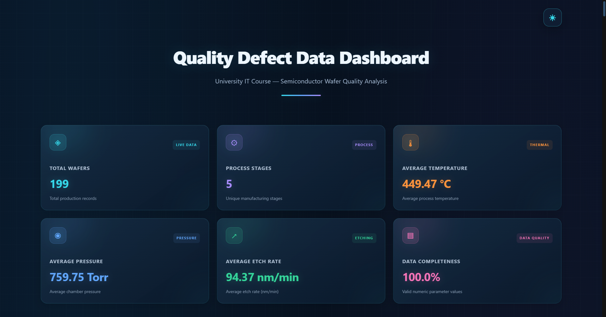

# 📊 Quality Defect Data Dashboard

### Semiconductor Wafer Quality & Process Analysis

An interactive dashboard for exploring semiconductor manufacturing data, monitoring process parameters, and identifying unusual observations through data visualization and statistical analysis.

[](https://noishin.github.io/Quality_Defect_Data_Project/)
[](https://github.com/noishin/Quality_Defect_Data_Project)
[](https://www.kaggle.com/datasets/meruvakodandasuraj/semiconductor-wafer-defect-classification-dataset/data)


---

## 📸 Dashboard Preview



*Main interface of the Quality Defect Data Dashboard.*

---

## 📑 Table of Contents

1. [Project Overview](#1-project-overview)
2. [Project Objectives](#2-project-objectives)
3. [Key Performance Indicators](#3-key-performance-indicators)
4. [Analytical Features](#4-analytical-features)
5. [Statistical Methodology](#5-statistical-methodology)
6. [Dataset](#6-dataset)
7. [Technologies and Tools](#7-technologies-and-tools)
8. [Project Structure](#8-project-structure)
9. [Access and Installation](#9-access-and-installation)
10. [Team Members](#10-team-members)
11. [Roles and Responsibilities](#11-roles-and-responsibilities)
12. [Project Scope and Limitations](#12-project-scope-and-limitations)
13. [Academic Context](#13-academic-context)

---

## 1. Project Overview

**Quality Defect Data Dashboard** is an interactive web-based data analysis and visualization project developed to explore semiconductor wafer manufacturing data and monitor important process-related quality indicators.

Semiconductor manufacturing involves multiple production stages and requires careful monitoring of operational parameters. Understanding variations in these parameters can provide valuable insights into manufacturing processes and help identify unusual observations that may require further investigation.

This project transforms semiconductor manufacturing records into an interactive analytical environment through statistical indicators, data visualizations, process comparisons, and wafer-level records.

The dashboard provides a centralized interface for exploring manufacturing data, examining process characteristics, and interpreting quality-related information.

## 2. Project Objectives

The primary objectives of this project are:

- Explore and organize semiconductor wafer manufacturing data.
- Monitor key process indicators through a KPI-based dashboard.
- Analyze temperature, pressure, and etch-rate measurements.
- Visualize wafer distribution across manufacturing stages.
- Examine variations in manufacturing parameters.
- Investigate relationships between selected process variables.
- Compare process characteristics across different manufacturing stages.
- Identify statistically unusual observations using an outlier detection method.
- Provide an interactive interface for searching and exploring individual wafer records.
- Present manufacturing information in a clear and accessible visual format.

## 3. Key Performance Indicators (KPIs)

The dashboard presents six primary indicators that summarize the manufacturing dataset.

| KPI | Description |
|---|---|
| **Total Wafers** | Total number of production records |
| **Process Stages** | Number of unique manufacturing stages |
| **Average Temperature** | Average process temperature (°C) |
| **Average Pressure** | Average chamber pressure (Torr) |
| **Average Etch Rate** | Average etching rate (nm/min) |
| **Data Completeness** | Valid numeric parameter values |

These indicators provide an initial overview of the dataset and serve as a starting point for more detailed analysis.

## 4. Analytical Features

The dashboard includes several analytical modules designed to examine different aspects of semiconductor manufacturing data.

### 4.1 Process Distribution

Visualizes the number of wafers recorded in each manufacturing stage. It provides an overview of how records are distributed across the production process.

### 4.2 Parameter Variation

Examines the variation of a selected manufacturing parameter across individual wafer records, allowing users to explore changes and identify unusual fluctuations.

### 4.3 Parameter Correlation

Explores the relationship between temperature and etch rate. The visualization supports exploratory analysis of how selected process variables change in relation to one another.

### 4.4 Process Stage Comparison

Compares the average value of a selected parameter across different manufacturing stages, helping users examine differences in process behavior.

### 4.5 Process Quality Monitoring

Uses the **Interquartile Range (IQR)** method to identify observations outside the statistical range of selected process parameters.

Detected observations are flagged for further investigation. They are statistical outliers and should not automatically be interpreted as defective wafers.

### 4.6 Wafer Quality Records

Provides a structured table for displaying and exploring individual manufacturing records.

Users can search records using:

- Wafer ID
- Manufacturing process step
- Process metric

## 5. Statistical Methodology

### Interquartile Range (IQR)

The IQR method identifies observations that are statistically distant from the central distribution of a parameter.

The interquartile range is calculated as:

\[
IQR = Q_3 - Q_1
\]

Where:

- \(Q_1\): First quartile (25th percentile)
- \(Q_3\): Third quartile (75th percentile)

The lower and upper boundaries are:

\[
Lower\ Bound = Q_1 - 1.5(IQR)
\]

\[
Upper\ Bound = Q_3 + 1.5(IQR)
\]

Observations outside these boundaries are flagged as potential statistical anomalies.

**Important:** A statistical outlier does not necessarily represent a manufacturing defect. Such observations require further investigation and should be interpreted within the context of the manufacturing process.

## 6. Dataset

The project uses the **Semiconductor Wafer Defect Classification Dataset**, available through Kaggle.

### Dataset Information

| Attribute | Description |
|---|---|
| Dataset Name | Semiconductor Wafer Defect Classification Dataset |
| Source | Kaggle |
| Domain | Semiconductor Manufacturing |
| Application | Manufacturing Data Analysis |
| Dataset Records | 199 |
| Manufacturing Stages | Deposition, Lithography, Etching, Oxidation, CMP |

### Dataset Features

| Feature | Description | Unit |
|---|---|---|
| Wafer ID | Unique wafer identifier | — |
| Temperature | Manufacturing process temperature | °C |
| Pressure | Process chamber pressure | Torr |
| Gas Flow | Gas flow rate | SCCM |
| Etch Rate | Material removal rate | nm/min |
| Voltage | Electrical voltage | V |
| Current | Electrical current | mA |
| Process Step | Manufacturing stage | — |

**Original Dataset:** [View on Kaggle](https://www.kaggle.com/datasets/meruvakodandasuraj/semiconductor-wafer-defect-classification-dataset/data)

The dataset is incorporated into the project through the JavaScript data file and serves as the basis for dashboard calculations and visualizations.

## 7. Technologies and Tools

| Technology | Purpose |
|---|---|
| HTML5 | Structuring the dashboard and its components |
| CSS3 | Interface styling, layout, and visual presentation |
| JavaScript | Data handling, calculations, and interactive functionality |
| Chart.js | Creating graphical representations of process data |
| Git | Version control and tracking code changes |
| GitHub | Source code hosting and team collaboration |
| GitHub Pages | Deploying and publishing the live dashboard |
| Kaggle | Providing the original dataset |

### Development Approach

The dashboard follows a browser-based implementation approach.

The dataset is incorporated into the project, processed through JavaScript, and presented through interactive visual components and statistical summaries.

Chart.js supports the graphical representation of manufacturing data, while the dashboard interface provides tools for navigating and exploring the available information.

## 8. Project Structure

```text
Quality_Defect_Data_Project/
│
├── index.html
├── data.js
├── dashboard.js
├── charts.js
├── quality-analysis.js
├── theme.js
├── style.css
├── ai_studio_code(1).js
│
├── assets/
│   └── dashboard-preview.png
│
└── README.md
```

| File | Description |
|---|---|
| `index.html` | Main structure of the web application |
| `data.js` | Dataset and manufacturing records |
| `dashboard.js` | Dashboard functionality and KPI presentation |
| `charts.js` | Data visualization and chart implementation |
| `quality-analysis.js` | Statistical quality analysis |
| `theme.js` | Theme-related functionality |
| `style.css` | Dashboard styling and layout |
| `assets/` | Images and other visual resources |
| `README.md` | Project documentation |

## 9. Access and Installation

### Online Access

The dashboard is publicly accessible through GitHub Pages.

[**🚀 Open Quality Defect Data Dashboard**](https://noishin.github.io/Quality_Defect_Data_Project/)

No additional installation is required to explore the deployed dashboard.

### Run Locally

**Step 1 — Clone the repository**

```bash
git clone https://github.com/noishin/Quality_Defect_Data_Project.git
```

**Step 2 — Navigate to the project directory**

```bash
cd Quality_Defect_Data_Project
```

**Step 3 — Open the project**

Open `index.html` in a modern web browser.

If external libraries are loaded through a CDN, an active internet connection is required.

Make sure all referenced files are located in the correct directories.

---

## 10. Team Members

This project was developed collaboratively by a team of four members as part of a university Information Technology course.

| No. | Team Member | GitHub Profile |
|---|---|---|
| 01 | **Noushin Alighardashi** | [@noishin](https://github.com/noishin) |
| 02 | **Arefeh Hosseini** | [@Arefehoseini](https://github.com/Arefehoseini) |
| 03 | **Madieh Masoumi** | [@mahdieh13851106-cell](https://github.com/mahdieh13851106-cell) |
| 04 | **Maryam Bigdeli** | [@bigdeli-maryam](https://github.com/bigdeli-maryam) |

## 11. Roles and Responsibilities

The project was developed collaboratively by four team members, with each member contributing to different aspects of project management, interface development, data analysis, visualization, and technical documentation.

### 1. Noushin Alighardashi

**Project Lead & Frontend/UI Developer**

- Leading and coordinating the project team and managing the overall development workflow.
- Planning project activities, supervising progress, and coordinating team responsibilities.
- Publishing and deploying the dashboard using GitHub Pages.
- Implementing Dark Mode functionality.
- Designing and implementing data tables for structured information presentation.
- Developing interactive filtering functionality for data exploration.
- Enhancing the website's visual design, layout, and overall user experience.
- Improving the dashboard's visual consistency, usability, and interface presentation.

GitHub: [@noishin](https://github.com/noishin)

### 2. Arefeh Hosseini

**Data Management, Statistical Analysis & Technical Documentation Specialist**

- Designing and implementing the wafer records table.
- Developing the correlation matrix and advanced data analysis components.
- Implementing Process Stage Intelligence to support the analysis of different manufacturing stages.
- Developing an IQR-based statistical quality risk detection system.
- Implementing CSV export functionality for filtered dataset records.
- Improving interface compatibility with Dark and Light themes.
- Preparing the project's technical report and documenting its implementation and analytical workflow.

GitHub: [@Arefehoseini](https://github.com/Arefehoseini)

### 3. Madieh Masoumi

**Frontend Developer & Interface Testing Specialist**

- Developing and implementing frontend components of the dashboard.
- Working with HTML, CSS, and JavaScript to build the web application.
- Supporting the implementation of interactive dashboard features.
- Contributing to slider development and visual interface functionality.
- Testing the dashboard locally on different computers and browsers.
- Checking the functionality of data tables, search features, and charts.
- Identifying browser console errors and supporting debugging and code correction.
- Improving the functionality and usability of the web application.

GitHub: [@mahdieh13851106-cell](https://github.com/mahdieh13851106-cell)

### 4. Maryam Bigdeli

**Data Analysis, Visualization & Dashboard Features Specialist**

- Contributing to the definition and documentation of the project topic: Semiconductor Wafer Quality Analysis.
- Preparing introductory and descriptive content for the dashboard.
- Developing explanations of the dashboard's purpose, functionality, and analytical capabilities.
- Documenting the dashboard as an interactive platform for process monitoring and statistical anomaly detection.
- Implementing Dark Mode functionality.
- Adding an image slideshow to the dashboard.
- Preparing descriptions of parameter selection and interactive data exploration.
- Creating introductory messages and project-related documentation.

GitHub: [@bigdeli-maryam](https://github.com/bigdeli-maryam)

### Team Collaboration

Although each team member had primary responsibilities, the project involved collaboration across different development areas.

The integration of project management, interface design, frontend development, data management, statistical analysis, visualization, testing, and technical documentation contributed to the development of an interactive dashboard for exploring semiconductor manufacturing data and analyzing process-related quality indicators.

### Team Collaboration

Although each member has a primary area of responsibility, the project represents a collaborative effort.

The integration of project coordination, interface design, data management, frontend development, and data visualization contributes to the overall functionality and presentation of the dashboard.

## 12. Project Scope and Limitations

The project focuses on exploratory data analysis, statistical summaries, and interactive visualization of semiconductor manufacturing records.

The following considerations are important when interpreting its results:

- Statistical outliers are indicators for further investigation, not confirmed manufacturing defects.
- Correlation visualizations describe relationships between variables and do not establish causation.
- Dashboard statistics depend on the dataset currently incorporated into the application.
- Data completeness refers to the validity of the numeric parameter values evaluated by the dashboard.
- The project is intended as an academic data analysis and visualization application, rather than a certified industrial quality-control system.

These considerations help ensure that the analytical outputs are interpreted appropriately.

## 13. Academic Context

| Category | Description |
|---|---|
| Project Title | Quality Defect Data Dashboard |
| Course | University Information Technology |
| Institution | Shahid Beheshti University (SBU) |
| Project Domain | Industrial Data Analysis |
| Application Area | Semiconductor Manufacturing |
| Main Focus | Wafer Quality and Process Analysis |
| Team Size | 4 Members |
| Dataset Source | Kaggle |
| Deployment Platform | GitHub Pages |

---

### Quality Defect Data Dashboard

**From Manufacturing Data to Data-Driven Insights.**

*Developed collaboratively as a university academic project.*
